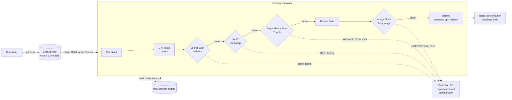

# DevSecOps Pipeline with Automated Security Gates for Container Deployment

A Jenkins CI/CD pipeline that **tests, security-scans, builds, scans again and deploys** a containerised Python Flask API. Every security check is an automatic **gate**: if a secret or a HIGH/CRITICAL issue is found, the build turns red and **nothing is deployed**.

Everything runs locally with Docker. You don't need a cloud account.

| Component | Technology |
|---|---|
| Sample app | Python Flask REST API (notes) + pytest |
| CI/CD server | Jenkins (declarative `Jenkinsfile`), running in Docker |
| Secret scanning | Gitleaks |
| SAST (static code analysis) | Semgrep |
| Dependency (SCA) + image scanning | Trivy |
| Container / deployment | Docker, Docker Compose |

---

## 1. Architecture



Jenkins runs in a container. It talks to the **host's** Docker engine through the mounted Docker socket. That lets it build images and start the app next to itself on the host. All scanners are installed **inside** the Jenkins image (`jenkins/Dockerfile`), so the pipeline calls them like normal commands.

## 2. Pipeline stages

| # | Stage | Tool | Purpose | Build fails when… | Report (archived) |
|---|---|---|---|---|---|
| 1 | Checkout | Git | Get the branch's source code | repo cannot be cloned | – |
| 2 | Unit Tests | pytest (in a venv) | Check the app works | any test fails | `junit.xml` (Test Result page) |
| 3 | Secret Scan | Gitleaks | Find passwords/API keys in the **whole git history** | **any** secret is detected | `gitleaks.json` |
| 4 | SAST | Semgrep (`.semgrep.yml`) | Find insecure code patterns (debug mode, shell injection, eval, unsafe YAML, hardcoded keys) | any rule matches (all rules = ERROR/HIGH) | `semgrep.json`, `semgrep.txt` |
| 5 | Dependency Scan | Trivy `fs` | Check pinned Python packages against CVE databases | a HIGH or CRITICAL CVE is found | `trivy-fs.json`, `trivy-fs.txt` |
| 6 | Docker Build | Docker | Build `notes-api:<branch>-<build#>` | Dockerfile error | – |
| 7 | Image Scan | Trivy `image` | Scan OS + Python packages inside the final image | a HIGH or CRITICAL CVE **that has a fix** is found | `trivy-image.json`, `trivy-image.txt` |
| 8 | Deploy | Docker Compose + curl | Run the scanned image on port 5000 and check `/health` | health check fails within 30 s | – |

How the gates work:
- Each scanner exits with code `1` when it finds a problem. That fails the `sh` step, and declarative Jenkins **skips every later stage**. So Deploy can only run when all gates are green.
- Deploy runs only on the `main` branch (`when { branch 'main' }`). Other branches are scanned but never deployed.
- `post { always }` publishes the JUnit results, archives every file in `reports/`, and prunes dangling images.
- `post { failure }` deletes the image that failed its gates, tears down a deployment that failed its health check, and (optionally) sends an alert.

## 3. Repository layout

```
app/                     Flask app, pinned requirements, pytest tests
Dockerfile               App image: python:3.12-slim, non-root user, gunicorn, HEALTHCHECK
docker-compose.yml       Runs the app on :5000 (read-only FS, healthcheck)
Jenkinsfile              The pipeline
.gitleaks.toml           Gitleaks config (default rules + path allowlist)
.semgrep.yml             Local Semgrep rules (work offline)
.trivyignore             Accepted CVEs (intentionally empty)
jenkins/                 Custom Jenkins image, plugins list, compose file
scripts/run-scans-locally.sh   Run all four security gates without Jenkins
docs/REPORT_NOTES.md     Draft sections for the college report
```

## 4. Quick start: the app on its own

```bash
docker compose up -d --build
curl http://localhost:5000/health                    # {"status":"ok"}
curl -X POST -H 'Content-Type: application/json' -d '{"text":"hello"}' http://localhost:5000/notes
curl http://localhost:5000/notes
docker compose down
```

To run the unit tests without Docker:

```bash
python3 -m venv .venv && .venv/bin/pip install -r app/requirements-dev.txt
.venv/bin/pytest app/tests -v
```

## 5. Jenkins setup

Prerequisites: Docker Engine or Docker Desktop (with WSL2 on Windows), with Docker Compose v2.

### 5.1 Start Jenkins

```bash
cd jenkins
# Tell compose which group owns the Docker socket (see "socket permissions" below)
echo DOCKER_GID=$(stat -c %g /var/run/docker.sock) > .env
docker compose up -d --build        # first build takes a few minutes
```

Open **http://localhost:8080**.

### 5.2 Unlock Jenkins

```bash
docker exec jenkins cat /var/jenkins_home/secrets/initialAdminPassword
```

1. Paste the password into the wizard.
2. On "Customize Jenkins", choose **Select plugins to install**, click **None**, then **Install**. All the plugins the pipeline needs are already baked into the image (`jenkins/plugins.txt`).
3. Create the admin user and keep the default Jenkins URL.

### 5.3 Create the Multibranch Pipeline job

1. **New Item**, name it `devsecops-pipeline`, choose **Multibranch Pipeline**, then **OK**.
2. **Branch Sources**, **Add source**, **Git**:
   - Project Repository: `https://github.com/<your-user>/<your-repo>.git`
   - Credentials: none for a public repo. For a private repo, add a GitHub username + Personal Access Token.
3. **Build Configuration**: Mode = *by Jenkinsfile*, Script Path = `Jenkinsfile`.
4. **Save**. Jenkins runs **Scan Multibranch Pipeline Now** automatically, finds the `main` and `vulnerable` branches, and builds both. You can click **Scan Multibranch Pipeline Now** again at any time to pick up new pushes.

> The first build downloads Trivy's vulnerability database (~100 MB). It is cached in the `jenkins_home` volume, so later builds are fast.

### 5.4 Docker socket permissions: the approach chosen

`jenkins/docker-compose.yml` mounts `/var/run/docker.sock`. The socket belongs to a group (`docker` on Linux, often `root` on Docker Desktop), and only members of that group can use it.

We use **`group_add: ["${DOCKER_GID}"]`**. The `jenkins` user inside the container joins the socket's group ID, which is read from `jenkins/.env`. That's all the access it needs.

Rejected alternatives:
- running Jenkins as `root`: gives far too much privilege
- `chmod 666 docker.sock`: lets every user on the host use the socket

> ⚠️ Anyone who can use the Docker socket is effectively root on the host. That's acceptable for a local lab. On a real server, use dedicated build agents or rootless/remote Docker.

The Deploy stage checks `http://host.docker.internal:5000/health`, because `localhost` inside the Jenkins container would be Jenkins itself. The name `host.docker.internal` is mapped to the host by `extra_hosts: host-gateway`.

## 6. Demo: vulnerable vs fixed

The repository has two branches with the **same Jenkinsfile**:

| Branch | Contents | Expected result |
|---|---|---|
| `vulnerable` | fake hardcoded AWS key (`app/config.py`), `PyYAML==5.3.1` (CVE-2020-14343, CRITICAL), `app.run(debug=True)` and `subprocess.run(..., shell=True)` | 🔴 **FAILED** at *Secret Scan (Gitleaks)*. Later stages are skipped and nothing is deployed. |
| `main` | the fixed, clean code | 🟢 **SUCCESS**: all gates pass and the app is deployed on http://localhost:5000 |

> All "secrets" in this repo are **fake** and exist only for the demo.

### Step-by-step (for the viva)

1. **Show the problem.** Open the `vulnerable` branch on GitHub and point out the four flaws:
   ```bash
   git diff main vulnerable
   ```
2. **Run the pipeline.** In Jenkins, open `devsecops-pipeline`, then **Scan Multibranch Pipeline Now**.
3. **Red build.** Open `vulnerable`, then the latest build:
   - Stage View: *Secret Scan (Gitleaks)* is red, and every later stage is grey (skipped).
   - Console Output shows `leaks found: …`.
   - **Build Artifacts**, `reports/gitleaks.json`: the finding (secret redacted), with file, line and commit.
4. **Show that the other gates would fail too.** Jenkins stops at the first failed gate. To show all four at once, run the same scanners locally:
   ```bash
   git checkout vulnerable
   ./scripts/run-scans-locally.sh      # needs the Jenkins image: cd jenkins && docker compose build
   git checkout main
   ```
   Result: `FAIL gitleaks / FAIL semgrep / FAIL trivy-fs / FAIL trivy-image`.
5. **Green build.** Open the `main` job:
   - Every stage is green in Stage View.
   - **Test Result** shows 7 passing tests.
   - Artifacts: all reports with zero findings.
   - `curl http://localhost:5000/health` returns `{"status":"ok"}`, and `docker ps` shows `notes-api … (healthy)`.
6. **Optional live fix.** On `vulnerable`, delete `app/config.py` and the `import config` line in `app/app.py`, then push and rescan. The build now fails at the **next** gate (Semgrep). That shows each gate works on its own. (Removing the key from the current code doesn't clear the Gitleaks finding, because it is still in git history. Real incident response rotates the key.)

## 7. Failure notifications (optional, disabled by default)

The `post { failure }` block can send an alert. Enable it by editing the `environment` block in the `Jenkinsfile`:

```groovy
NOTIFY_ENABLED = 'true'
NOTIFY_CHANNEL = 'telegram'   // or 'email'
NOTIFY_EMAIL   = 'you@example.com'
```

**Telegram**
1. Create a bot with [@BotFather](https://t.me/BotFather) and copy the token.
2. Send your bot a message. Then get your chat id from `https://api.telegram.org/bot<TOKEN>/getUpdates`.
3. In Jenkins, go to **Manage Jenkins → Credentials → (global) → Add Credentials**. Add two credentials of kind **Secret text**, with IDs `telegram-bot-token` and `telegram-chat-id`.

**Email**
Configure SMTP under **Manage Jenkins → System → Extended E-mail Notification** (for example Gmail SMTP with an app password), then set `NOTIFY_CHANNEL = 'email'`.

Secrets are read with `withCredentials`, so they are masked in the console log and never stored in the repo.

## 8. Configuration files

| File | What it does |
|---|---|
| `.gitleaks.toml` | Uses Gitleaks' built-in rules (`useDefault = true`) and ignores `reports/` and `.venv/` |
| `.semgrep.yml` | 5 local rules mapped to CWE/OWASP. Local rules make the scan work offline and give the same result every run. When online you can add `--config p/python --config p/owasp-top-ten`. |
| `.trivyignore` | Empty on purpose. Accepting a CVE requires adding its ID here, with a justification. |

## 9. Troubleshooting

| Symptom | Fix |
|---|---|
| `permission denied … docker.sock` in a build | Check `jenkins/.env` has the right `DOCKER_GID` (`stat -c %g /var/run/docker.sock`), then `docker compose up -d` again |
| Deploy: `port is already allocated` | Something else is using port 5000. Run `docker compose down` in the repo, or stop the other container. |
| Deploy health check fails | Run `docker logs notes-api`. Also check that `host.docker.internal` resolves inside Jenkins: `docker exec jenkins getent hosts host.docker.internal` |
| Trivy is slow on the first run | It is downloading its DB (once). Later runs use the cache. |
| Image Scan fails on `main` months later | A new CVE was published for the base image or a package. Rebuild with the newest `python:3.12-slim` and bump the pins. This is the gate doing its job. |
